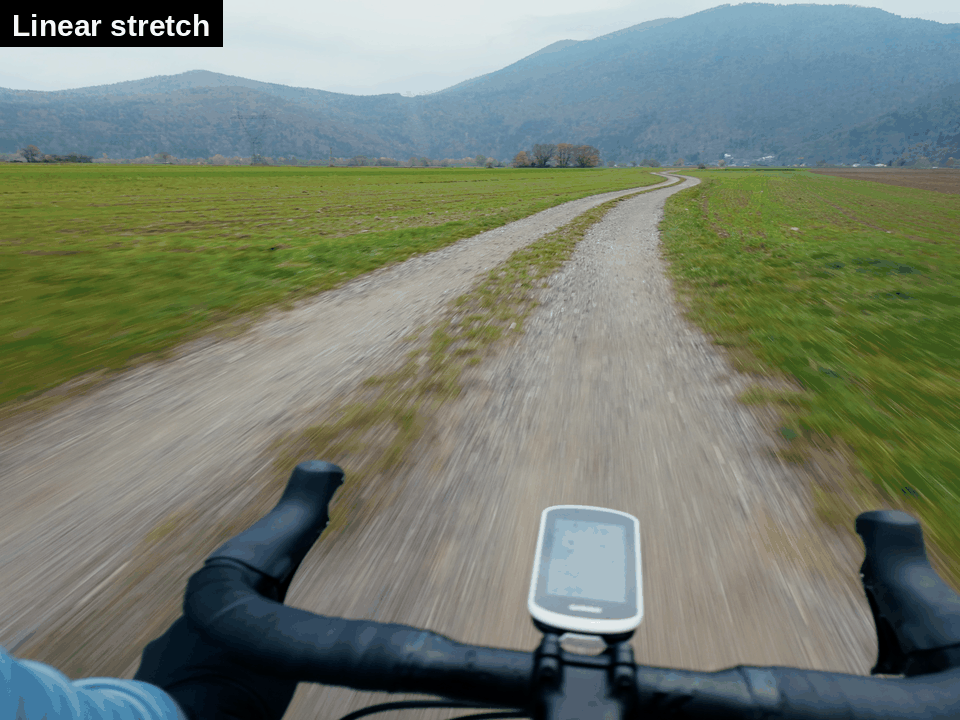
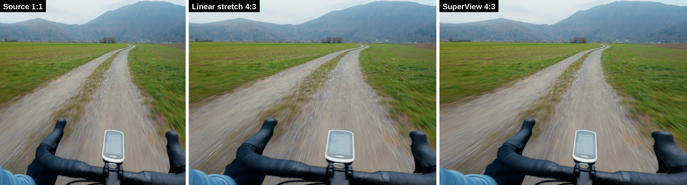
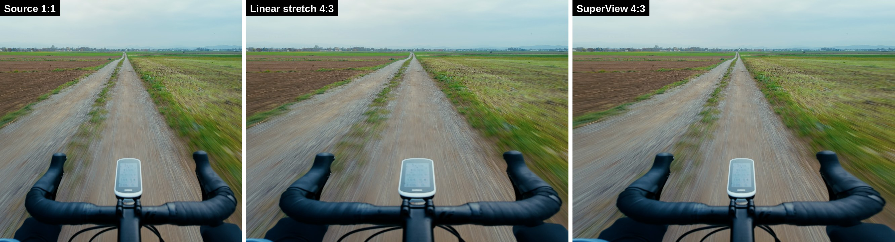
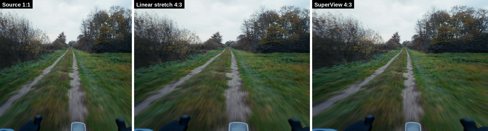
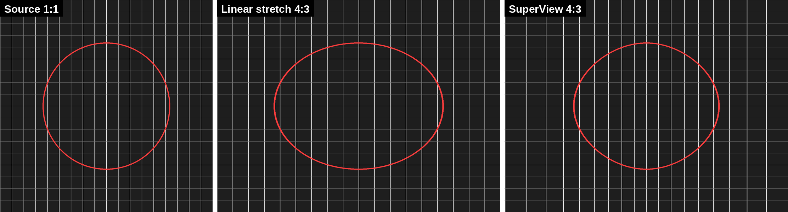
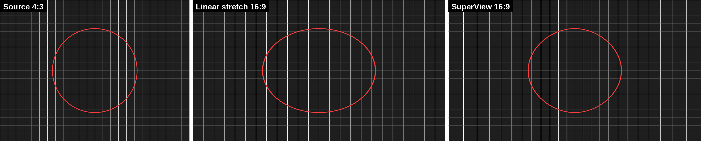

# resolve-superview

A DCTL for DaVinci Resolve that applies a SuperView-style stretch. It fills a wider frame with a narrower clip, for example 1:1 into 4:3 or 4:3 into 16:9. The center of the image keeps its proportions. The stretch increases towards the left and right edges.



## Examples

### Real footage: DJI Osmo Pocket 3, 1:1 to 4:3





The linear stretch makes the bike computer and the handlebar too wide. SuperView keeps them at their real width and puts the stretch into the grass at the edges.

The 1:1 panels were recovered from the 4:3 render with the inverse of the mapping.

### Test grids, rendered in Resolve




In the SuperView result, the grid spacing at the center is the same as in the source. The circle in the center gets much less wide than with the linear stretch.

## How it works

The DCTL uses the curve from [Niek/superview](https://github.com/Niek/superview), the open-source SuperView tool for GoPro footage. For each output column, the source column is:

```
t      = output position from the center, from -1 (left edge) to 1 (right edge)
source = output - sign(t) * t^2 * (output width - source width) / 2
```

At the center, the scale is 1:1. For 1:1 to 4:3 and for 4:3 to 16:9, the stretch at the edges is 2x. Rows do not move. The DCTL resamples each row with Catmull-Rom interpolation.

Resolve applies a DCTL only inside the bounds of the clip. A narrow clip in a wide timeline leaves the side bars outside the effect. For this reason, the clip must first fill the frame with a linear stretch (Zoom X). The DCTL then removes that linear stretch and applies the SuperView curve.

In test renders, the grid lines were less than 0.4 px from the positions that the formula gives.

## Install

1. Copy `superview.dctl` into the Resolve LUT folder:
   - Linux: `/opt/resolve/LUT/`
   - macOS: `/Library/Application Support/Blackmagic Design/DaVinci Resolve/LUT/`
   - Windows: `C:\ProgramData\Blackmagic Design\DaVinci Resolve\Support\LUT\`
2. Restart Resolve, or click **Project Settings > Color Management > Lookup Tables > Update Lists**.

## Use

1. Set the timeline resolution to the output aspect, for example 4096 x 3072 for 4:3 or 3840 x 2160 for 16:9.
2. Select the clip and open **Inspector > Transform**.
3. Unlink the zoom and set **Zoom X** to the value in the table. Keep **Zoom Y** at 1.

   | Source | Output | Zoom X |
   |---|---|---|
   | 1:1 | 4:3 | 1.333 |
   | 4:3 | 16:9 | 1.333 |
   | 3:2 | 16:9 | 1.185 |

4. On the Color page, add the **DCTL** effect to a node and select `superview`.
5. Set **Source aspect** to the aspect of the clip.

To use the same settings on many clips, put the clips in a group. Then add the DCTL to the group post-clip node.

If you apply the DCTL as a LUT (right-click the node > LUTs), Resolve does not show the controls. In this case, the DCTL uses a 1:1 source.

For a source aspect that is not in the list, set **Source aspect** to **Custom**. Then set **Custom source aspect** to the width divided by the height. Zoom X is the output aspect divided by the source aspect.

## Requirements

Tested with DaVinci Resolve Studio 21.1 on Linux.

## License

GPL-3.0, the same license as [Niek/superview](https://github.com/Niek/superview). See [LICENSE](LICENSE).
